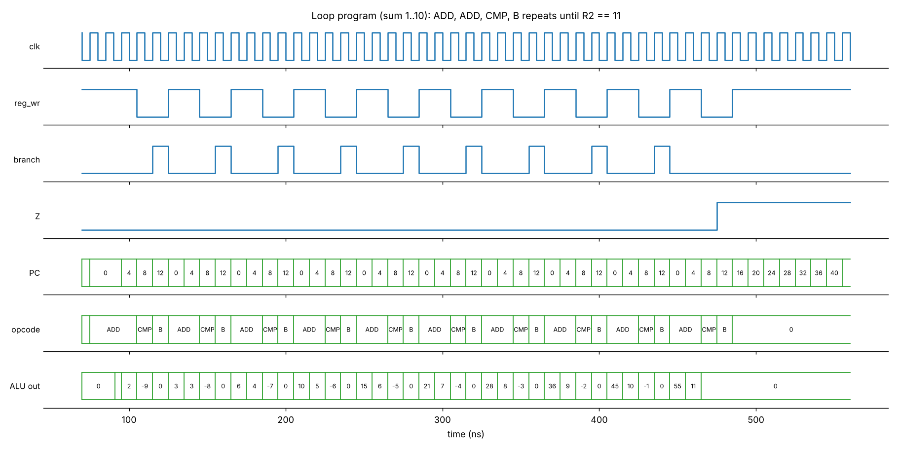

# 🧠 StepCore — Single-Cycle 32-bit ARM-Subset Processor (SystemVerilog, Synopsys VCS)

> **A from-scratch single-cycle CPU: fetch, decode, execute and write-back in one clock, running a real loop program to compute 1 + 2 + … + 10 = 55.**

A **32-bit single-cycle processor** in **SystemVerilog** that implements a subset of the **ARM** instruction set: data processing (ADD, SUB, AND, BIC), flag-setting compares (CMP, TST), memory access (LDR, STR) and control flow (B, BL). It is built from modular RTL blocks (PC, instruction ROM, register file, ALU, data RAM and control unit) and verified with a self-checking testbench in **Synopsys VCS**. All datapath vectors use a **bit-reversed `[0:31]` ordering** throughout.

<p align="center"></p>

## Features

- **Single-cycle datapath:** every instruction completes in one clock (10 ns period in simulation).
- **16 × 32-bit register file** with two asynchronous read ports, one synchronous write port and synchronous reset.
- **ALU:** add, subtract, AND, bit-clear, plus a zero flag.
- **Status flag:** a Z bit (CPSR-style) latched only by CMP/TST and used for conditional branching.
- **Harvard memories:** 64-word instruction ROM and 64-word data RAM (word-aligned, `addr / 4`).
- **Branch with link:** BL saves `PC + 4` into **R14 (LR)**.
- **Cycle-by-cycle trace:** the core prints FETCH / DECODE / READ / EXEC / WRITE / BRANCH for every instruction.
- **Self-checking testbench** with runtime operands via `+A=` / `+B=` plusargs.

## Architecture

```
          ┌──────┐   addr   ┌────────┐  inst   ┌──────────────────────────┐
  clk ──► │  PC  │ ───────► │  IMEM  │ ──────► │  Decode / Control Unit   │
          └──▲───┘          └────────┘         │  opcode, Rn, Rm, Rd      │
             │ branch_en / target              └──┬────────┬──────────┬───┘
             │                                    │ a1,a2  │ alu_ctrl │ mem_we / mem_to_reg
             │                              ┌─────▼────┐   │          │
             │                              │ REGFILE  │ rd1, rd2     │
             │                              │ 16 × 32  │ ──┬──────────┼──────────┐
             │                              └─────▲────┘   │          │          │
             │                                    │   ┌────▼────┐  ┌──▼───────┐  │
             └──────────── Z flag (CMP/TST) ──────┼── │   ALU   │  │   DMEM   │◄─┘ (addr = Rn, data = Rm)
                                                  │   └────┬────┘  └────┬─────┘
                                                  └── writeback mux ◄───┘  (ALU result or RAM data; PC+4 for BL)
```

| Module | File | Role |
|---|---|---|
| `arm_core` | `rtl/arm_core.sv` | Top level: instruction decode, control unit, Z flag, writeback mux, trace output |
| `pc` | `rtl/pc.sv` | Program counter: `+4` each cycle, or the branch target |
| `imem` | `rtl/imem.sv` | 64-word instruction ROM, asynchronous read |
| `regfile` | `rtl/regfile.sv` | 16 × 32-bit registers, 2R / 1W |
| `alu` | `rtl/alu.sv` | ADD / SUB / AND / BIC with zero flag |
| `dmem` | `rtl/dmem.sv` | 64-word data RAM: asynchronous read (LDR), synchronous write (STR) |
| `tb_arm_core` | `tb/tb_arm_core.sv` | Loads programs, injects operands, checks results |

## Instruction Set

Instruction fields follow the ARM data-processing layout: **opcode `[21:24]`, Rn `[16:19]`, Rd `[12:15]`, Rm `[0:3]`**. The data-processing opcodes match ARM's.

| Opcode | Instruction | Operation | Writes Rd | Sets Z |
|---|---|---|---|---|
| `0100` | **ADD** Rd, Rn, Rm | Rd ← Rn + Rm | ✓ | |
| `0010` | **SUB** Rd, Rn, Rm | Rd ← Rn − Rm | ✓ | |
| `0000` | **AND** Rd, Rn, Rm | Rd ← Rn & Rm | ✓ | |
| `1110` | **BIC** Rd, Rn, Rm | Rd ← Rn & ~Rm | ✓ | |
| `1010` | **CMP** Rn, Rm | Rn − Rm (flags only) | | ✓ |
| `1000` | **TST** Rn, Rm | Rn & Rm (flags only) | | ✓ |
| `0111` | **LDR** Rd, [Rn] | Rd ← MEM[Rn] | ✓ | |
| `0101` | **STR** Rm, [Rn] | MEM[Rn] ← Rm | | |
| `1011` | **B** | if Z = 0: PC ← 0 (loop start; branch while not equal) | | |
| `1111` | **BL** | R14 ← PC + 4, PC ← 0 | R14 | |

## Verification

The testbench runs two programs and checks each result automatically.

**Test 1: minimal program.** `SUB R3, R1, R2` with operands injected from the command line (defaults A = 15, B = 1).

**Test 2: looping program.** Computes the sum of 1 to 10 using a CMP + conditional branch loop:

```asm
loop:  ADD R1, R1, R2     ; C += i
       ADD R2, R2, R3     ; i += 1
       CMP R2, R4         ; compare i with 11
       B   loop           ; repeat while i != 11
; initial: R1 = 0 (C), R2 = 1 (i), R3 = 1, R4 = 11  →  R1 = 55
```

**Results**

| Run | Expected | Result |
|---|---|---|
| Test 1, A = 15, B = 1 | R3 = 14 | ✅ PASS |
| Test 1, A = 100, B = 37 | R3 = 63 | ✅ PASS |
| Test 1, A = 7, B = 7 | R3 = 0 | ✅ PASS |
| Test 2, sum 1..10 | R1 = 55 | ✅ PASS (10 iterations, 40 instructions) |

Example trace (full log in [`docs/sample_output.txt`](docs/sample_output.txt)):

```
[Cycle at 25 ns] --------------------------
  FETCH  : PC=0 | Inst=0x20031100
  DECODE : Op=4'b0010 | Rn=R1 | Rm=R2 | Rd=R3
  READ   : Reg[R1]=15 | Reg[R2]=1
  EXEC   : ALU Result=14 | Zero=0
  WRITE  : Storing ALU 14 into Register R3
----------------------------------------------
[SUCCESS] MINIMAL TEST PASSED! C (R3) = 14
...
[SUCCESS] LOOP TEST PASSED! C (R1) = 55
```

The waveform at the top shows the loop running: PC cycles 0 → 4 → 8 → 12 while the branch is taken, the ALU accumulates 1, 3, 6, … 45, 55, and once CMP sets Z the branch stops and execution falls through.

## Run It

**Synopsys VCS** (the simulator used for development):

```bash
make                     # compile + run with A=15, B=1
make run A=100 B=37      # custom operands for test 1
make gui                 # interactive waveform debugging in DVE / Verdi
make clean
```

or manually:

```bash
vcs -sverilog -full64 -debug_access+all -timescale=1ns/1ps tb/tb_arm_core.sv rtl/*.sv -o simv
./simv +A=15 +B=1
```

## Possible Extensions

- Exercise LDR / STR and BL in the testbench (the datapath supports them).
- Immediate operands and PC-relative branch offsets (branch targets are currently fixed at address 0).
- Full NZCV flags and ARM condition codes.
- 5-stage pipeline with hazard detection and forwarding.

## Author

- **Aryan Verma**
